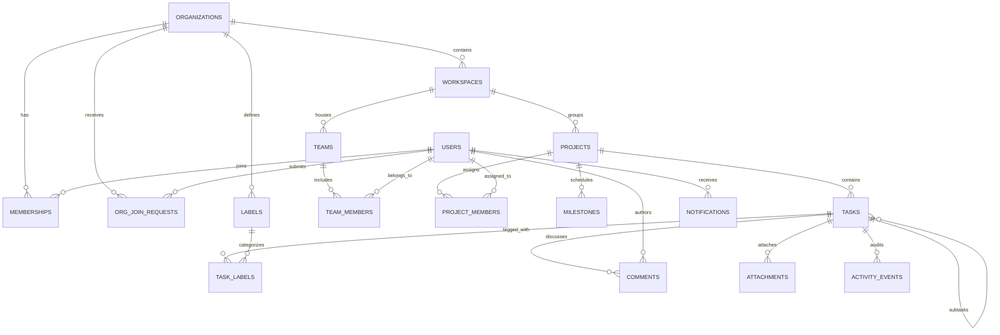

# TeamFlow — Database Schema & API Reference

This reference document provides the complete technical specification for TeamFlow's database architecture, stored procedures, serverless Edge Functions, and client-side service APIs.

---

## 📑 Table of Contents

1. [Database Schema Overview](#1-database-schema-overview)
2. [Migration Changelog](#2-migration-changelog)
3. [Complete Data Dictionary (17 Tables)](#3-complete-data-dictionary-17-tables)
4. [Stored Procedures & Stored Functions (RPC)](#4-stored-procedures--stored-functions-rpc)
5. [Supabase Edge Functions Reference](#5-supabase-edge-functions-reference)
6. [Frontend Service APIs](#6-frontend-service-apis)

---

## 1. Database Schema Overview

TeamFlow's data layer runs on Supabase PostgreSQL with strict Row Level Security (RLS) on all tables. Data relationships follow a multi-tenant hierarchy anchored at `organizations`.

---

## 2. Migration Changelog

The database schema is constructed through 7 modular migration files:

| Migration File | Description |
|---|---|
| `20261020000000_initial_schema.sql` | Establishes the 16 core relational tables, foreign key constraints, indexes, and base RLS policies. |
| `20261020000001_seed_data.sql` | Seeds initial synthetic test datasets for two isolated organizations: **Acme Labs** and **BrightWave Studio**. |
| `20261020000002_module_enhancements.sql` | Adds `email_status` column to `notifications`, enables `supabase_realtime` publication, and installs `run_overdue_scan` and `get_project_kpis` RPCs. |
| `20261020000003_storage_setup.sql` | Creates the private `attachments` storage bucket with authenticated RLS policies. |
| `20261023000003_fix_org_creation_rls.sql` | Grants authenticated users permission to insert new organizations and creates the initial `owner` membership row. |
| `20261023000004_company_join_and_user_profile.sql` | Extends `public.users` with personal profile fields, creates `public.org_join_requests`, installs `search_organizations` and `approve_join_request` RPCs. |
| `20261024000005_fix_user_auth_and_profile_rls.sql` | Enforces profile RLS, creates `handle_new_user` trigger on `auth.users`, and replicates user metadata into `public.users`. |

---

## 3. Complete Data Dictionary (17 Tables)

### 1. `organizations`
The root tenant record. All workspaces, projects, and tasks belong to an organization.
* `id` (`uuid`, PK): Default `gen_random_uuid()`.
* `name` (`text`, NOT NULL): Display name of the company.
* `slug` (`text`, NOT NULL, UNIQUE): URL-friendly unique identifier.
* `logo_url` (`text`): Image URL for company avatar/logo.
* `default_timezone` (`text`, DEFAULT `'UTC'`): Default timezone for scheduled reminders.
* `created_at` (`timestamptz`, DEFAULT `now()`).
* `updated_at` (`timestamptz`, DEFAULT `now()`).

### 2. `users`
Mirrored profile data from `auth.users`.
* `id` (`uuid`, PK): Corresponds to `auth.users.id`.
* `email` (`text`, NOT NULL, UNIQUE).
* `name` (`text`, NOT NULL): Full display name.
* `avatar_url` (`text`): Profile photo or preset image URL.
* `timezone` (`text`, DEFAULT `'UTC'`).
* `phone` (`text`): Contact number.
* `job_title` (`text`): e.g., "Senior Software Engineer".
* `department` (`text`): e.g., "Product Engineering".
* `bio` (`text`): Short biography.
* `created_at` (`timestamptz`, DEFAULT `now()`).

### 3. `memberships`
Links a user to an organization with a specific role.
* `id` (`uuid`, PK): Default `gen_random_uuid()`.
* `org_id` (`uuid`, NOT NULL, FK ➔ `organizations.id` ON DELETE CASCADE).
* `user_id` (`uuid`, NOT NULL, FK ➔ `users.id` ON DELETE CASCADE).
* `role` (`text`, NOT NULL): Must be one of `'owner'`, `'manager'`, `'employee'`.
* `joined_at` (`timestamptz`, DEFAULT `now()`).
* **Constraint**: `UNIQUE(org_id, user_id)`.

### 4. `org_join_requests`
Pending or decided employee requests to join an organization.
* `id` (`uuid`, PK): Default `gen_random_uuid()`.
* `org_id` (`uuid`, NOT NULL, FK ➔ `organizations.id` ON DELETE CASCADE).
* `user_id` (`uuid`, NOT NULL, FK ➔ `users.id` ON DELETE CASCADE).
* `status` (`text`, DEFAULT `'pending'`): Must be `'pending'`, `'approved'`, `'rejected'`, `'cancelled'`.
* `role_requested` (`text`, DEFAULT `'employee'`): Must be `'employee'` or `'manager'`.
* `note` (`text`): Optional message from applicant.
* `decided_by` (`uuid`, FK ➔ `users.id`).
* `decided_at` (`timestamptz`).
* `created_at` (`timestamptz`, DEFAULT `now()`).

### 5. `workspaces`
Logical containers within an organization (e.g., "Engineering", "Marketing").
* `id` (`uuid`, PK): Default `gen_random_uuid()`.
* `org_id` (`uuid`, NOT NULL, FK ➔ `organizations.id` ON DELETE CASCADE).
* `name` (`text`, NOT NULL).
* `description` (`text`).
* `is_archived` (`boolean`, DEFAULT `false`).
* `created_at` (`timestamptz`, DEFAULT `now()`).

### 6. `teams`
Functional teams inside a workspace.
* `id` (`uuid`, PK): Default `gen_random_uuid()`.
* `org_id` (`uuid`, NOT NULL, FK ➔ `organizations.id` ON DELETE CASCADE).
* `workspace_id` (`uuid`, NOT NULL, FK ➔ `workspaces.id` ON DELETE CASCADE).
* `name` (`text`, NOT NULL).
* `created_at` (`timestamptz`, DEFAULT `now()`).

### 7. `team_members`
Association between users and teams.
* `id` (`uuid`, PK): Default `gen_random_uuid()`.
* `team_id` (`uuid`, NOT NULL, FK ➔ `teams.id` ON DELETE CASCADE).
* `user_id` (`uuid`, NOT NULL, FK ➔ `users.id` ON DELETE CASCADE).
* **Constraint**: `UNIQUE(team_id, user_id)`.

### 8. `projects`
Projects containing tasks, milestones, and assigned members.
* `id` (`uuid`, PK): Default `gen_random_uuid()`.
* `org_id` (`uuid`, NOT NULL, FK ➔ `organizations.id` ON DELETE CASCADE).
* `workspace_id` (`uuid`, NOT NULL, FK ➔ `workspaces.id` ON DELETE CASCADE).
* `name` (`text`, NOT NULL).
* `code` (`text`, NOT NULL): e.g., "ENG", "DES".
* `description` (`text`).
* `status` (`text`, DEFAULT `'active'`): `'active'`, `'archived'`, `'completed'`.
* `created_at` (`timestamptz`, DEFAULT `now()`).

### 9. `project_members`
Explicit project assignment granting access to Employees.
* `id` (`uuid`, PK): Default `gen_random_uuid()`.
* `project_id` (`uuid`, NOT NULL, FK ➔ `projects.id` ON DELETE CASCADE).
* `user_id` (`uuid`, NOT NULL, FK ➔ `users.id` ON DELETE CASCADE).
* `project_role` (`text`, DEFAULT `'member'`): `'lead'`, `'member'`.
* **Constraint**: `UNIQUE(project_id, user_id)`.

### 10. `milestones`
Deliverable target checkpoints with due dates.
* `id` (`uuid`, PK): Default `gen_random_uuid()`.
* `project_id` (`uuid`, NOT NULL, FK ➔ `projects.id` ON DELETE CASCADE).
* `org_id` (`uuid`, NOT NULL, FK ➔ `organizations.id` ON DELETE CASCADE).
* `title` (`text`, NOT NULL).
* `due_date` (`date`).
* `status` (`text`, DEFAULT `'open'`): `'open'`, `'reached'`.

### 11. `tasks`
The primary unit of work.
* `id` (`uuid`, PK): Default `gen_random_uuid()`.
* `org_id` (`uuid`, NOT NULL, FK ➔ `organizations.id` ON DELETE CASCADE).
* `project_id` (`uuid`, NOT NULL, FK ➔ `projects.id` ON DELETE CASCADE).
* `parent_id` (`uuid`, FK ➔ `tasks.id` ON DELETE CASCADE): For subtasks.
* `title` (`text`, NOT NULL).
* `description` (`text`).
* `status` (`text`, DEFAULT `'backlog'`): `'backlog'`, `'todo'`, `'in_progress'`, `'in_review'`, `'done'`, `'cancelled'`.
* `priority` (`text`, DEFAULT `'medium'`): `'low'`, `'medium'`, `'high'`, `'urgent'`.
* `assignee_id` (`uuid`, FK ➔ `users.id` ON DELETE SET NULL).
* `creator_id` (`uuid`, NOT NULL, FK ➔ `users.id`).
* `due_date` (`timestamptz`).
* `completed_at` (`timestamptz`): Recorded automatically when status changes to `'done'`.
* `position` (`integer`, DEFAULT `0`): For column sorting in Kanban.
* `is_archived` (`boolean`, DEFAULT `false`).
* `created_at` (`timestamptz`, DEFAULT `now()`).
* `updated_at` (`timestamptz`, DEFAULT `now()`).

### 12. `labels`
Custom tags defined at the organization level.
* `id` (`uuid`, PK): Default `gen_random_uuid()`.
* `org_id` (`uuid`, NOT NULL, FK ➔ `organizations.id` ON DELETE CASCADE).
* `name` (`text`, NOT NULL).
* `color` (`text`, NOT NULL): Hex color code (e.g., `#6366f1`).

### 13. `task_labels`
Many-to-many join between tasks and labels.
* `task_id` (`uuid`, NOT NULL, FK ➔ `tasks.id` ON DELETE CASCADE).
* `label_id` (`uuid`, NOT NULL, FK ➔ `labels.id` ON DELETE CASCADE).
* **Constraint**: `PRIMARY KEY(task_id, label_id)`.

### 14. `comments`
Chronological threaded messages on tasks.
* `id` (`uuid`, PK): Default `gen_random_uuid()`.
* `task_id` (`uuid`, NOT NULL, FK ➔ `tasks.id` ON DELETE CASCADE).
* `user_id` (`uuid`, NOT NULL, FK ➔ `users.id` ON DELETE CASCADE).
* `content` (`text`, NOT NULL).
* `created_at` (`timestamptz`, DEFAULT `now()`).

### 15. `attachments`
Metadata for files uploaded to the private storage bucket.
* `id` (`uuid`, PK): Default `gen_random_uuid()`.
* `task_id` (`uuid`, NOT NULL, FK ➔ `tasks.id` ON DELETE CASCADE).
* `uploader_id` (`uuid`, NOT NULL, FK ➔ `users.id`).
* `file_name` (`text`, NOT NULL).
* `file_size` (`bigint`, NOT NULL): Size in bytes (max 10MB).
* `mime_type` (`text`, NOT NULL).
* `storage_path` (`text`, NOT NULL): Path inside `attachments` bucket.
* `checksum` (`text`): SHA-256 hex string computed on client.
* `created_at` (`timestamptz`, DEFAULT `now()`).

### 16. `activity_events`
Immutable audit log of all entity state mutations.
* `id` (`uuid`, PK): Default `gen_random_uuid()`.
* `org_id` (`uuid`, NOT NULL, FK ➔ `organizations.id` ON DELETE CASCADE).
* `entity_type` (`text`, NOT NULL): `'task'`, `'project'`, `'comment'`.
* `entity_id` (`uuid`, NOT NULL).
* `actor_id` (`uuid`, NOT NULL, FK ➔ `users.id`).
* `action` (`text`, NOT NULL): e.g., `'status_changed'`, `'task_assigned'`.
* `details` (`jsonb`, DEFAULT `'{}'::jsonb`): State diff snapshot.
* `created_at` (`timestamptz`, DEFAULT `now()`).

### 17. `notifications`
In-app notification records.
* `id` (`uuid`, PK): Default `gen_random_uuid()`.
* `user_id` (`uuid`, NOT NULL, FK ➔ `users.id` ON DELETE CASCADE).
* `org_id` (`uuid`, NOT NULL, FK ➔ `organizations.id` ON DELETE CASCADE).
* `type` (`text`, NOT NULL): `'task_assigned'`, `'status_changed'`, `'comment_added'`, `'due_date_approaching'`, `'task_overdue'`.
* `title` (`text`, NOT NULL).
* `message` (`text`, NOT NULL).
* `read` (`boolean`, DEFAULT `false`).
* `dedupe_key` (`text`): Deterministic key for anti-noise filtering.
* `email_status` (`text`, DEFAULT `'simulated_sent'`): Simulated email dispatch status.
* `created_at` (`timestamptz`, DEFAULT `now()`).

---

## 4. Stored Procedures & Stored Functions (RPC)

### `public.get_org_role(target_org_id uuid) ➔ text`
Returns the caller's role (`'owner'`, `'manager'`, `'employee'`, or `NULL`) within the specified organization by querying `public.memberships`. Used extensively across Row Level Security policies.

### `public.search_organizations(search_query text) ➔ TABLE`
Allows authenticated users to search registered organizations by name or slug. Returns:
* `id` (`uuid`)
* `name` (`text`)
* `slug` (`text`)
* `created_at` (`timestamptz`)
* `member_count` (`bigint`)

### `public.approve_join_request(request_id uuid, assigned_role text) ➔ jsonb`
Atomically executes the approval of a company join request:
1. Validates that the caller is an `owner` or `manager` of the target organization.
2. Checks that the join request is in `'pending'` status.
3. Inserts a new row into `public.memberships` assigning the designated role.
4. Updates the request status to `'approved'` and records `decided_by` and `decided_at`.
5. Returns a confirmation JSON object: `{"success": true, "membership_id": "...", "role": "..."}`.

### `public.run_overdue_scan(target_org_id uuid) ➔ jsonb`
Scans for open eligible tasks in the given organization with `due_date < now()`. Generates in-app notifications with deduplication keys and sets `email_status = 'simulated_sent'`.

### `public.get_project_kpis(target_project_id uuid, target_org_id uuid) ➔ jsonb`
Computes KPI metrics on the database server adhering to the zero-denominator rule: returns total tasks, done count, completion rate, and on-time percentage.

---

## 5. Supabase Edge Functions Reference

### 1. `teamflow-ai`
* **Endpoint**: `/functions/v1/teamflow-ai`
* **Invocation**: `supabase.functions.invoke('teamflow-ai', { body: { action, ...params } })`
* **Actions Supported**:
  * `breakdown`:
    * Request: `{ "action": "breakdown", "title": string, "description": string }`
    * Response: `{ "subtasks": [{ "title": string, "estimated_minutes": number }] }`
  * `enhance`:
    * Request: `{ "action": "enhance", "title": string, "description": string }`
    * Response: `{ "enhanced": string }` (Agile formatted: Context, Objective, Acceptance Criteria)
  * `suggest_priority`:
    * Request: `{ "action": "suggest_priority", "title": string, "description": string, "due_date": string }`
    * Response: `{ "priority": "low" | "medium" | "high" | "urgent", "rationale": string }`

### 2. `overdue-checker`
* **Endpoint**: `/functions/v1/overdue-checker`
* **Invocation**: Called periodically by scheduled triggers.
* **Function**: Scans all active tasks across all tenants, matches assignees, dispatches deduplicated alerts, and logs simulated email dispatches.

---

## 6. Frontend Service APIs

The application encapsulates business logic in dedicated TypeScript service modules:

| Service File | Responsibilities | Key Methods |
|---|---|---|
| [`aiService.ts`](file:///src/services/aiService.ts) | Communicates with the `teamflow-ai` Edge Function with graceful local fallback | `aiBreakdownTask`, `aiEnhanceDescription`, `aiSuggestPriority` |
| [`analyticsService.ts`](file:///src/services/analyticsService.ts) | Implements KPI mathematical formulas, zero-denominator safeguards, and CSV generator | `computeAnalyticsSummary`, `computeMemberWorkloads`, `computeProgressTrend`, `generateAnalyticsCsv` |
| [`joinRequestService.ts`](file:///src/services/joinRequestService.ts) | Manages company discovery and membership join requests | `searchCompanies`, `submitJoinRequest`, `getMyJoinRequests`, `getIncomingJoinRequests`, `approveJoinRequest`, `rejectJoinRequest`, `cancelJoinRequest` |
| [`notificationService.ts`](file:///src/services/notificationService.ts) | Handles notification creation, anti-noise deduplication, and read state | `notifyTaskAssigned`, `notifyStatusChanged`, `notifyCommentAdded`, `notifyDueDateChanged`, `markAllAsRead` |

