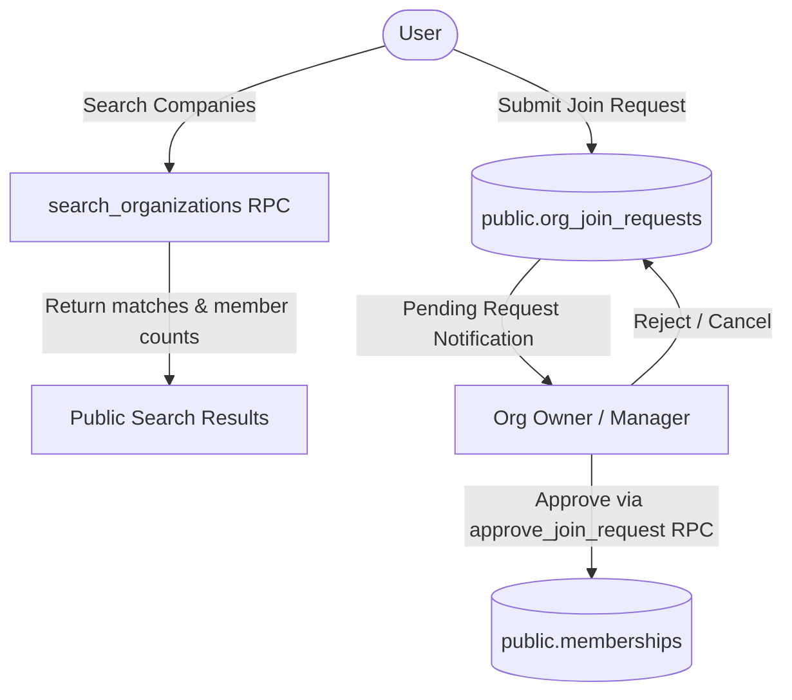
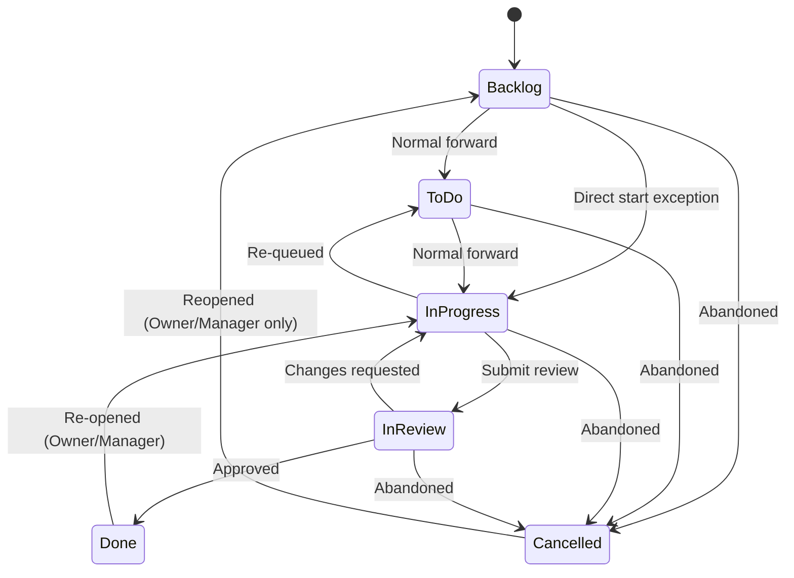
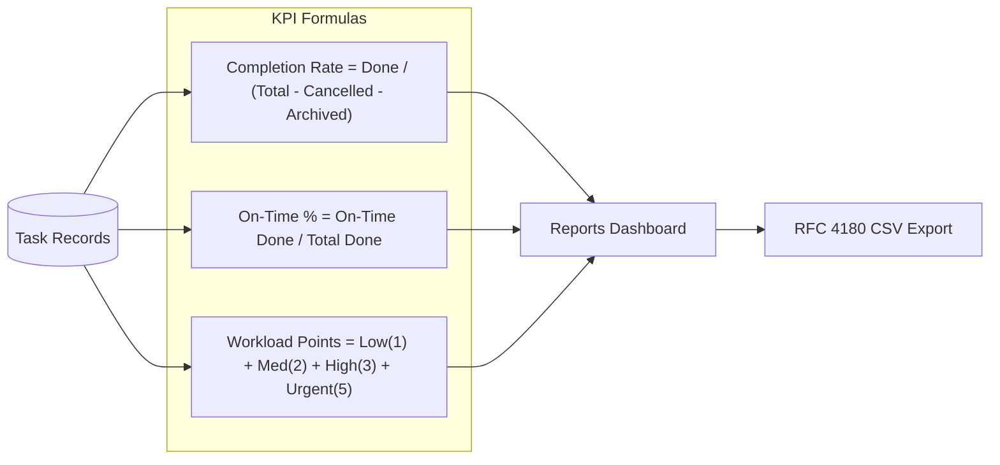

# TeamFlow — Project Features & Functional Guide

This document provides a comprehensive, feature-by-feature walkthrough of **TeamFlow**, a modern multi-tenant Project Management and Team Collaboration SaaS platform. It explains the capabilities, user journeys, interaction patterns, and business rules implemented across the entire application.

---

## 📑 Table of Contents

1. [Landing Page & Interactive 3D IsoGlow Engine](#1-landing-page--interactive-3d-isoglow-engine)
2. [Authentication & Profile Management](#2-authentication--profile-management)
3. [Companies Hub & Join Request System](#3-companies-hub--join-request-system)
4. [Workspaces, Projects & Milestones](#4-workspaces-projects--milestones)
5. [Accessible Kanban Board & Task List View](#5-accessible-kanban-board--task-list-view)
6. [Task Management, Subtasks & AI Copilot](#6-task-management-subtasks--ai-copilot)
7. [Team Collaboration, Attachments & Audit Trail](#7-team-collaboration-attachments--audit-trail)
8. [Personal Dashboard ("My Work")](#8-personal-dashboard-my-work)
9. [Executive Reports & Mathematical KPI Engine](#9-executive-reports--mathematical-kpi-engine)
10. [Notification Center & Automated Overdue Scanner](#10-notification-center--automated-overdue-scanner)
11. [Organization Settings, Member RBAC & Security Audit](#11-organization-settings-member-rbac--security-audit)

---

## 1. Landing Page & Interactive 3D IsoGlow Engine

The TeamFlow landing page (`/` and `/landing`) serves as an interactive marketing and demonstration gateway. It incorporates custom isometric graphics with dynamic real-time interaction.

### Key Capabilities:
* **Interactive 3D IsoGlow Canvas**:
  * Implemented using pure HTML5 Canvas and mathematical projections in [`IsoEngine.ts`](file:///src/components/isoglow/IsoEngine.ts) and [`IsoGlowCanvas.tsx`](file:///src/components/isoglow/IsoGlowCanvas.tsx).
  * Features three procedural 3D wireframe figures:
    1. **Office Tower** (`officeTower.ts`): Visualizing organizational architecture and multi-tenant structures.
    2. **Desk Computer** (`deskComputer.ts`): Representing individual workspace ergonomics and task execution.
    3. **TeamFlow Engine** (`teamflowEngine.ts`): Visualizing collaborative pipelines and state machines.
  * Real-time cursor tracking, perspective tilting, ambient pulse effects, and dynamic neon lighting.
* **Interactive Product Simulators**:
  * **Kanban Simulator**: Allows users to interact with mock task columns directly on the landing page before creating an account.
  * **AI Breakdown Simulator**: Demonstrates generative subtask breakdown and agile user story structuring in real time.
  * **Multi-Tenant Isolation Simulator**: An interactive toggle between "Acme Labs" and "BrightWave Studio" showcasing how PostgreSQL Row Level Security guarantees data partitioning.
  * **Interactive KPI Calculator**: Adjust done vs. eligible task sliders to see live on-time completion rates and workload points update dynamically with zero-denominator safety.
* **Navigation & Call-to-Actions**: Direct paths for login, account registration, and exploring live test environments.

---

## 2. Authentication & Profile Management

User authentication and account lifecycle are powered by Supabase Auth with automated synchronization to internal application profiles.

### Key Capabilities:
* **Sign Up & Registration** ([`RegisterPage.tsx`](file:///src/pages/auth/RegisterPage.tsx)):
  * Account creation requiring full name, email, and password.
  * Form validation enforced with Zod schemas and feedback alerts.
  * Automated trigger (`handle_new_user` in PostgreSQL) immediately creates a synchronized profile in `public.users`.
* **Login & Session Management** ([`LoginPage.tsx`](file:///src/pages/auth/LoginPage.tsx)):
  * Secure credential authentication issuing JWT access and refresh tokens.
  * Persistent sessions stored in local browser state with automatic token refreshing.
  * Pre-configured quick-login credentials for testing both test organizations (**Acme Labs** and **BrightWave Studio**).
* **Password Recovery Flow** ([`ForgotPasswordPage.tsx`](file:///src/pages/auth/ForgotPasswordPage.tsx) & [`ResetPasswordPage.tsx`](file:///src/pages/auth/ResetPasswordPage.tsx)):
  * Secure magic link / recovery email dispatch.
  * Password update confirmation page with strength indicators.
* **User Profile Hub** ([`ProfilePage.tsx`](file:///src/pages/profile/ProfilePage.tsx)):
  * View and update personal information: Full Name, Job Title, Department, Phone Number, Bio, and Timezone.
  * Avatar Selection: Choose from curated high-resolution avatar presets or input custom image URLs.
  * Membership Overview: See all companies the user currently belongs to along with their granted role (`Owner`, `Manager`, or `Employee`).

---

## 3. Companies Hub & Join Request System

The Companies Hub ([`CompaniesHubPage.tsx`](file:///src/pages/companies/CompaniesHubPage.tsx)) provides a central management hub for multi-company participation.

### Key Capabilities:
* **Active Companies Grid**:
  * Displays all organizations the user belongs to with role badges, member counts, and direct "Enter Company" buttons.
  * Instant tenant context switching updating the global application state ([`OrgContext.tsx`](file:///src/context/OrgContext.tsx)).
* **Company Search & Discovery**:
  * Search across registered organizations using PostgreSQL `search_organizations` stored procedure.
  * Real-time debounced query returning matching company names, slugs, creation dates, and team sizes.
* **Join Request Workflow** ([`joinRequestService.ts`](file:///src/services/joinRequestService.ts)):
  * Send join requests specifying the desired role (`employee` or `manager`) and an optional cover note.
  * Users can track their pending requests and cancel them at any time.
  * Company Owners and Managers receive incoming join requests in **Organization Settings ➔ Incoming Requests** and can approve or decline them with a single click.

---

## 4. Workspaces, Projects & Milestones

Work within an organization is hierarchically organized: **Organization ➔ Workspaces ➔ Projects ➔ Milestones & Tasks**.

### Key Capabilities:
* **Workspaces** ([`WorkspacesPage.tsx`](file:///src/pages/workspaces/WorkspacesPage.tsx)):
  * Logical groupings representing departments (e.g., "Engineering", "Marketing", "Product Design").
  * Workspace creation, description editing, and archiving.
* **Projects & Project Teams**:
  * Projects are scoped inside workspaces with unique project codes (e.g., `ENG-01`, `DES-02`).
  * Explicit project membership: In accordance with RBAC rules, **Employees** can only view and interact with projects where they have been explicitly added as a project member.
  * **Owners** and **Managers** retain organization-wide visibility across all projects regardless of explicit membership.
* **Milestone Tracking** ([`ProjectOverviewPage.tsx`](file:///src/pages/projects/ProjectOverviewPage.tsx)):
  * Time-bound milestones with due dates and target delivery windows.
  * Milestone health summaries tracking completed vs. open tasks.

---

## 5. Accessible Kanban Board & Task List View

The project board ([`ProjectBoardPage.tsx`](file:///src/pages/board/ProjectBoardPage.tsx)) delivers an enterprise-grade interactive task workflow adhering to modern accessibility guidelines.

### Key Capabilities:
* **Fluid Drag-and-Drop** ([`KanbanBoard.tsx`](file:///src/components/kanban/KanbanBoard.tsx)):
  * Powered by `@dnd-kit/core` and `@dnd-kit/sortable` for zero-lag 60 FPS transitions.
  * Visual drop indicators, collision detection, and smooth column reflow.
* **WCAG AA Accessible Keyboard Navigation**:
  * Every task card includes an accessible "Move To..." menu.
  * Full keyboard shortcuts modal ([`KeyboardShortcutsModal.tsx`](file:///src/components/task/KeyboardShortcutsModal.tsx)) with fast keybindings:
    * `C`: Create new task
    * `F` or `/`: Focus search filter
    * `1` - `5`: Move focused task across columns (Backlog, To Do, In Progress, In Review, Done)
    * `Esc`: Close open modals
* **Dual View Mode**:
  * Toggle effortlessly between the interactive **Kanban Board** and a structured **Task List View** ([`TaskListView.tsx`](file:///src/components/task/TaskListView.tsx)).
* **Task Templates & Quick Presets**:
  * Pre-configured templates for rapid task generation:
    * `🐛 Bug Report`: Prefills reproduction steps, expected results, and environment info.
    * `🚀 Feature Spec`: Formats user stories, architectural context, and acceptance criteria.
    * `⚡ Performance Spike`: Pre-structures benchmark targets and profiling goals.
* **Multi-Attribute Filtering**:
  * Live search by title and description.
  * Filter by priority (`Low`, `Medium`, `High`, `Urgent`), assignee, and custom tags/labels.

---

## 6. Task Management, Subtasks & AI Copilot

The task detail modal ([`TaskDetailModal.tsx`](file:///src/components/task/TaskDetailModal.tsx)) provides deep control over the task lifecycle.

### Key Capabilities:
* **Strict Task Status State Machine** ([`statusTransitions.ts`](file:///src/utils/statusTransitions.ts)):
  * Validates every transition against Document 1 §10 specifications.
  * Disallows non-adjacent workflow jumps (e.g., jumping from `Backlog` straight to `Done` is strictly rejected with user-friendly error banners).
  * Enforces role boundaries: Cancelled tasks can only be reopened by **Owners** or **Managers**.
  * **Optimistic Updates & Automatic Rollback**: The UI applies card moves instantly; if the backend rejects the transition or a network glitch occurs, the card snaps back smoothly to its previous column with an alert.
* **Subtasks with Visual Progress**:
  * Create, toggle, and delete nested subtasks.
  * Real-time percentage progress bar and completed item counters displayed directly on task cards.
* **AI Task Acceleration Copilot** ([`aiService.ts`](file:///src/services/aiService.ts)):
  * Connected to Supabase Edge Function `teamflow-ai` with multi-model fallback on OpenRouter:
    1. **AI Subtask Breakdown**: Automatically analyzes task descriptions to generate 3 to 5 actionable subtasks with time estimates.
    2. **AI Agile Description Enhancement**: Formats brief notes into professional user stories with User Context, Implementation Objectives, and Clear Acceptance Criteria.
    3. **AI Priority Recommendation**: Analyzes urgency and impact to suggest optimal priority ratings.
* **Organization Labels & Tags** ([`LabelManagerModal.tsx`](file:///src/components/labels/LabelManagerModal.tsx)):
  * Create, edit, and color-code organization-wide labels.
  * Tag tasks for instant visual categorisation and filtering.

---

## 7. Team Collaboration, Attachments & Audit Trail

TeamFlow keeps discussions, files, and change history centralized inside each task.

### Key Capabilities:
* **Threaded Comments**:
  * Real-time chronological discussion feed.
  * Markdown rendering, user timestamps, and role badges.
  * Comment deletion boundaries: Regular employees can only delete their own comments; Managers and Owners can moderate any comment.
* **Private File Attachments**:
  * Upload images, documents, spreadsheets, and archives directly to Supabase Storage.
  * **Client-Side SHA-256 Checksum Calculation**: Every uploaded file is hashed in the browser (`crypto.subtle.digest`) and verified against duplicate corruption.
  * Strict validation: Max file size capped at **10 MB** (FR-COL-02) with MIME type allowlists.
  * Secure signed download URLs preventing unauthorized external access.
* **Immutable Activity Audit Log**:
  * Append-only event history tracking every action: task creation, status changes, assignee modifications, due date shifts, subtask completions, and file uploads.
  * Provides complete transparency for compliance and sprint retrospectives.

---

## 8. Personal Dashboard ("My Work")

The personal dashboard ([`MyWorkPage.tsx`](file:///src/pages/dashboard/MyWorkPage.tsx)) aggregates an individual contributor's responsibilities across all projects in the active organization.

### Key Capabilities:
* **Chronological Time Buckets**:
  * **🚨 Overdue**: Urgent attention items where `due_date < today`.
  * **📅 Due Today**: Deliverables requiring completion by end of day.
  * **🗓️ Due This Week**: Upcoming sprint commitments within the next 7 days.
  * **⏳ Later / No Due Date**: Backlog items and long-range goals.
* **Quick Status Actions**: Update task progress directly from the personal stream without having to locate the parent project board.
* **Personal Productivity Metrics**: Instant visibility into personal open tasks, completion velocity, and pending deadlines.

---

## 9. Executive Reports & Mathematical KPI Engine

The Reports & Analytics dashboard ([`ReportsPage.tsx`](file:///src/pages/reports/ReportsPage.tsx)) provides mathematical certainty for project managers and executives.

### Key Capabilities:
* **Mathematical Truth & Zero-Denominator Safety**:
  * Strict implementation of Document 1 §9 KPI formulas in [`analyticsService.ts`](file:///src/services/analyticsService.ts):
    * **Task Completion Rate**: $\text{Rate} = \frac{\text{Done Tasks}}{\text{Eligible Tasks}} \times 100\%$ where eligible tasks exclude archived and cancelled tasks.
    * **Zero-Denominator Rule**: When no eligible tasks exist, metrics explicitly display `0.0%` (or `"N/A"`) instead of `NaN`, infinity, or blank errors.
    * **On-Time Completion Rate**: Percentage of completed tasks where `completed_at <= due_date`.
* **Cognitive Workload Points**:
  * Calculates team member stress and capacity using priority weight scoring:
    * $\text{Low} = 1\text{ pt}$, $\text{Medium} = 2\text{ pts}$, $\text{High} = 3\text{ pts}$, $\text{Urgent} = 5\text{ pts}$.
  * Highlights overallocated members to help managers balance sprint capacity.
* **Interactive Data Visualizations**:
  * **Cumulative Progress Curves**: Area chart powered by Recharts illustrating task creation vs. completion velocity over time.
  * **Status Distribution**: Donut charts showing task breakdown across columns.
* **Transparent Calculation Rules Modal** ([`CalculationRulesModal.tsx`](file:///src/components/reports/CalculationRulesModal.tsx)):
  * An in-app reference explaining every mathematical formula, weight multiplier, and filtering rule.
* **RFC 4180 Compliant CSV Export**:
  * Generates enterprise-ready CSV reports with properly escaped strings, formulas, and timestamps for external spreadsheet auditing.

---

## 10. Notification Center & Automated Overdue Scanner

TeamFlow ensures team members never miss critical updates while actively guarding against notification spam.

### Key Capabilities:
* **In-App Notification Center** ([`NotificationsPage.tsx`](file:///src/pages/notifications/NotificationsPage.tsx) & [`NotificationDropdown.tsx`](file:///src/components/notifications/NotificationDropdown.tsx)):
  * Unread count badges on the top navigation bar.
  * Interactive dropdown drawer and dedicated full-page inbox.
  * One-click "Mark All as Read" and filter by event category (`task_assigned`, `status_changed`, `comment_added`, `due_date_approaching`, `task_overdue`).
* **Anti-Noise Notification Deduplication**:
  * Prevents duplicate alerts using deterministic notification fingerprints (`overdue:{taskId}:{dueDate}`).
  * If an overdue task is scanned multiple times on the same day, only a single notification is dispatched.
* **Automated Overdue Detection Engine**:
  * **Client Background Hook** ([`useOverdueEngine.ts`](file:///src/hooks/useOverdueEngine.ts)): Runs automatic overdue checks when users navigate workspaces.
  * **Serverless Edge Function** ([`supabase/functions/overdue-checker/index.ts`](file:///supabase/functions/overdue-checker/index.ts)): Scans open eligible tasks across all projects, records simulated email dispatch (`email_status = 'simulated_sent'`), and appends audit logs.

---

## 11. Organization Settings, Member RBAC & Security Audit

The Organization Settings page ([`OrgSettingsPage.tsx`](file:///src/pages/organizations/OrgSettingsPage.tsx)) manages enterprise configuration, team memberships, and security compliance.

### Key Capabilities:
* **Organization Profile**: Update company display name, slug, and default timezone.
* **Member Management & Role Assignment**:
  * Invite new team members by email address.
  * Role selection: Assign `Owner`, `Manager`, or `Employee` roles.
  * **Last-Owner Guard**: The system prevents demoting or removing the last remaining owner of an organization, guaranteeing the tenant cannot be orphaned.
  * **Manager Protection Boundary**: Managers cannot remove or demote Owners.
* **Incoming Join Requests Hub**: Review, approve, or reject employee join requests with assigned roles.
* **Live In-Browser Security & Compliance Audit Runner** ([`crossTenantAudit.ts`](file:///src/tests/crossTenantAudit.ts)):
  * Allows administrators to trigger an automated live security audit verifying:
    * `SEC-01`: Cross-tenant foreign organization isolation.
    * `SEC-02`: Role-Based Access Control enforcement.
    * `SEC-03`: Status transition state machine rules.
    * `SEC-04`: KPI zero-denominator safety.
    * `SEC-05`: Storage attachment boundary protection.
* **Danger Zone**:
  * Delete organization and cascade-purge all associated workspaces, projects, tasks, and attachments.
  * Strict verification requiring typing the organization slug to prevent accidental deletion.
  * Accessible only to users holding the `Owner` role.

